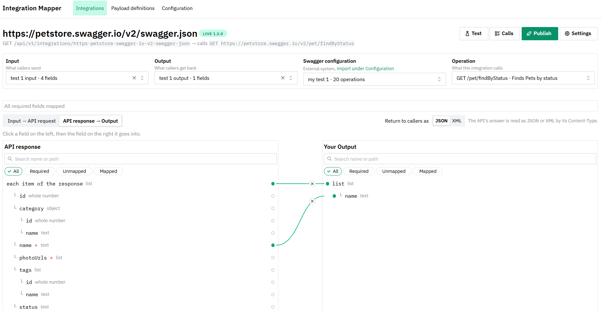
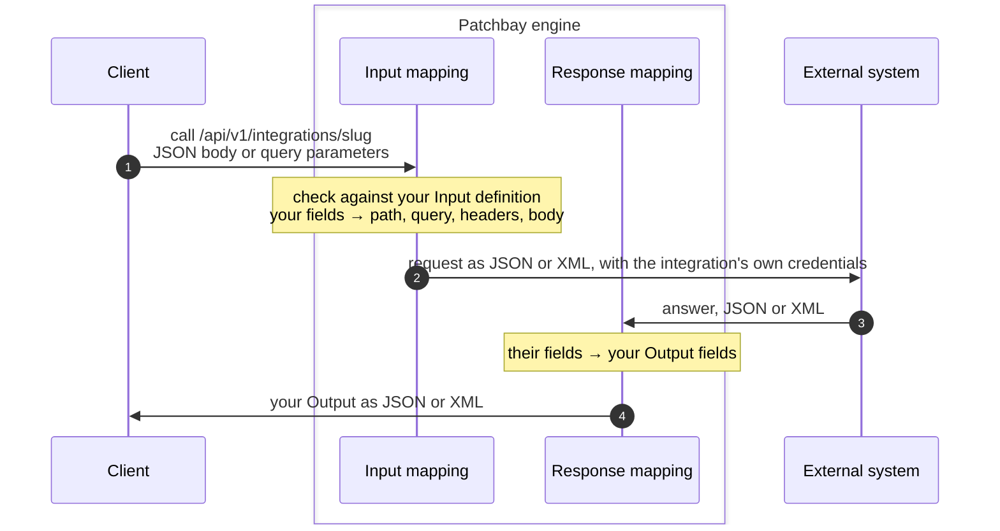

<p align="center"></p>

<h1 align="center">Patchbay</h1>

<p align="center"><b>Draw lines between two APIs. Get a live endpoint.</b></p>

Connect your own data model to an external REST API without writing code. Import the API's OpenAPI (Swagger) file, draw lines from your fields to theirs in the browser, and press **Publish**. The result is a live, versioned REST endpoint that callers can use, served by the same container.



The name comes from the patch bay of a studio or server room: a panel where any output is connected to any input with a short cable, without rebuilding anything behind it.

## Why use it

Most integration work is the same small job over and over: take what a caller sends, reshape it into what another system expects, call it, and reshape the answer back. Usually that means a new service, a mapping class, tests, a deployment and a change request every time a field moves. Here it is a board you edit and a button you press.

- **No code to keep alive.** The mapping is plain JSON in a folder. The engine turns it into Apache Camel routes and DataSonnet scripts when it starts or when you publish, so there is nothing generated to maintain.
- **Your model stays yours.** Callers see your field names and shapes, not the vendor's. When the vendor changes, you move a line, not your callers.
- **Try before you publish.** **Test** runs a sample through exactly the code a live call uses, against a mock built from the contract or the real system, and shows each step: what the caller sent, the request that went out, the answer, and your Output.
- **Safe changes.** Every publish is an immutable version. Links that can't work are shown in red and block publishing. Any earlier version can be made live again with one click, without a restart.
- **JSON or XML.** Send the request to the external system as JSON or XML and return JSON or XML to callers, with one switch per direction. XML answers are read automatically.
- **See what happened.** **Calls** shows the last live calls step by step, including where a failed one stopped.
- **Callers get documentation.** Every live integration appears in an OpenAPI document at `/api/openapi.json`, ready for Swagger UI, code generators, or for another integration to call.
- **One small container.** No database, no message broker. Configuration is files you can keep in Git.

## How a call flows



1. **The client calls the integration** with the same HTTP method as the external operation: a JSON body for POST, PUT and PATCH, query parameters for GET and DELETE. The engine checks the call against your Input definition and answers `400` with every problem listed if it doesn't fit. Then your links build the external request: path parameters, query parameters, headers and body. Fields the caller did not send are left out.
2. **The request goes out** as JSON or XML. The caller's own headers never reach the external system; the integration adds its own credentials.
3. **The external system answers** in JSON or XML. If it answers with an error, the caller gets the same status and body; if it is too slow or unreachable, the caller gets `504` or `502`.
4. **The caller gets your Output.** Your response links turn the answer into your Output, list by list and field by field, and the caller gets it as JSON or XML. The call appears under **Calls** on the board.

## What you need

| To | Install |
|---|---|
| Run it with Docker | Docker (Docker Desktop on Windows and macOS) |
| Build and run it without Docker | Java 21 or newer, Maven 3.9 or newer, Node.js 24 with npm |

No database or other service is needed. Everything is stored as JSON files in one folder.

## Run it with Docker

```bash
cd engine
docker build -t patchbay .
docker run -p 8080:8080 -v mapper-config:/config patchbay
```

Open **http://localhost:8080**. Your work is saved in the named volume `mapper-config` and survives restarts and new images. To use a folder on your computer instead, mount it (`-v ./mapper-config:/config`); on Linux create it first and give it to the container user: `mkdir mapper-config && sudo chown 10001 mapper-config`.

With variables (see the table below):

```bash
docker run -p 8080:8080 -v mapper-config:/config \
  -e INBOUND_API_KEY=choose-a-long-random-value \
  -e MAPPER_SECRET_CREATE_USER=your-gorest-token \
  patchbay
```

## Run it without Docker

```bash
cd engine/console
npm install
npm run build          # builds the console into engine/src/main/resources/static
cd ..
mvn clean package      # runs the tests and builds target/engine-0.0.1-SNAPSHOT.jar
java -jar target/engine-0.0.1-SNAPSHOT.jar --mapper.config-dir=config
```

Open **http://localhost:8080**. `config/` in the repository has three published examples that call the public [FakeRESTApi](https://fakerestapi.azurewebsites.net/index.html); use another folder to start empty (`--mapper.config-dir=my-config`, created on the first save).

Working on the console with hot reload: keep the engine running, then in `engine/console` run `npm run dev` and open http://localhost:5173 (API calls go to the engine on 8080).

Tests: `mvn test` in `engine/` (no internet needed) and `npm test` in `engine/console/`.

## Variables

None are required. Set them as environment variables (`-e` with Docker), or for the first three also as a command-line option of the jar.

| Variable | Default | What it does |
|---|---|---|
| `MAPPER_CONFIGDIR` (option `--mapper.config-dir`) | `config` (in Docker: `/config`) | Folder with all configuration: payload definitions, contracts, integrations, versions and secrets. |
| `SERVER_PORT` (option `--server.port`) | `8080` | Port of the console, the admin API and the published integrations. |
| `MAPPER_OUTBOUNDTIMEOUTMS` (option `--mapper.outbound-timeout-ms`) | `10000` | How long a call to an external system may take, in milliseconds; after that the caller gets `504`. |
| `INBOUND_API_KEY` | not set | When set, every call to a published integration, the console and the admin API must send this value in the `X-API-Key` header, otherwise `401`. The console asks for it once per browser tab. Not set: nothing is checked, which is meant for a closed Docker network only. |
| `MAPPER_URL_<ID>` | not set | The base URL of a Swagger configuration's connection in this environment, for example `MAPPER_URL_FAKE_REST_API` for the configuration `fake-rest-api` (id in capitals, other characters as `_`). It wins over the address set with **Connection** under Configuration. |
| `MAPPER_SECRET_<SLUG>` | not set | The token or API key an integration sends to its external system, for example `MAPPER_SECRET_CREATE_USER` for the integration `create-user` (slug in capitals, other characters as `_`). It wins over a secret typed on the integration's Settings page. |
| `MAPPER_CALL_LOG` | `on` | `on` keeps the last 100 live calls of each integration in memory, with what the caller sent, the request sent out, the answer and the mapped output, shown under **Calls** on the board. `off` keeps none of that; each call still writes one line without data to the log. |

## Security in short

- Without `INBOUND_API_KEY`, anyone who can reach the port can use the console and every integration, including the stored credentials of the external systems. Set it whenever the port is reachable from outside a closed network.
- Secrets typed on a Settings page are stored **unencrypted** in `<config>/secrets/<slug>.json`, readable only by the engine's user on Linux and in Docker (Windows does not enforce it). Use `MAPPER_SECRET_<SLUG>` to keep them out of the folder.
- Headers that callers send (including `X-API-Key` and `Authorization`) never reach the external system.
- The OpenAPI documents under `/api/openapi` can be read without `INBOUND_API_KEY`. They show integration names and field shapes, never data or secrets.
- The call log holds real payloads, which may include personal data, and anyone with console access can see them. Auth values are shown as `***`. Set `MAPPER_CALL_LOG=off` where that is not acceptable.

## How to build an integration

1. **Configuration:** import the external system's Swagger or OpenAPI file (upload or URL). Every integration can use it. Its **Connection** holds the base URL in this environment, taken from the file when it has an absolute server address.
2. **Payload definitions** (optional): describe what your callers send and get back, by hand or from a pasted JSON sample.
3. **Integrations → New integration**, then on its board pick the Input, the Output, the Swagger configuration and the operation. Leave Input or Output empty to have it created from the operation, already linked.
4. **Map:** click a field on the left, then the field on the right it goes into; a line connects them. Red lines can't be published; amber warnings can. **Test** runs a sample through the same code as a live call. The JSON/XML switch next to the tabs sets how the request goes out and what callers get back.
5. **Publish:** shows the live URL and a ready `curl` command. Earlier versions can be made active again.
6. **Calls:** every live call, step by step, with where it stopped if it failed. `docker logs` shows one line per call.
7. **OpenAPI:** `http://localhost:8080/api/openapi.json` describes every live integration, `/api/openapi/<slug>.json` one of them (linked from the Integrations list and the Publish dialog). Give it to callers, or import it under Configuration so one integration can call another; then set that integration's base URL to the engine itself and, if `INBOUND_API_KEY` is set, its auth to an API key in the `X-API-Key` header.

Authentication and the secret are on the integration's **Settings** page; the base URL belongs to the Swagger configuration's connection.

## Environments

Integrations and their versions never contain an address or a secret: they name a connection, and each environment sets that connection's base URL (`MAPPER_URL_<ID>` or **Connection** under Configuration) and the integrations' secrets (`MAPPER_SECRET_<SLUG>` or Settings). So the same version file can run in DEV, TEST and LIVE. The folders `connections/` and `secrets/` in the configuration folder belong to their environment and are not copied along. Integrations published before connections existed keep their literal base URL in those older version files until they are published again.

## More

- `engine/README.md`: file formats, admin calls, lists, error shapes, known behavior.
- `docs/slice-plan.md`: the plan and every design decision (D-…, R-…); `docs/integration-mapper-spec.md`: the long-term spec.
- `DESIGN.md`: the console's design tokens and rules.
