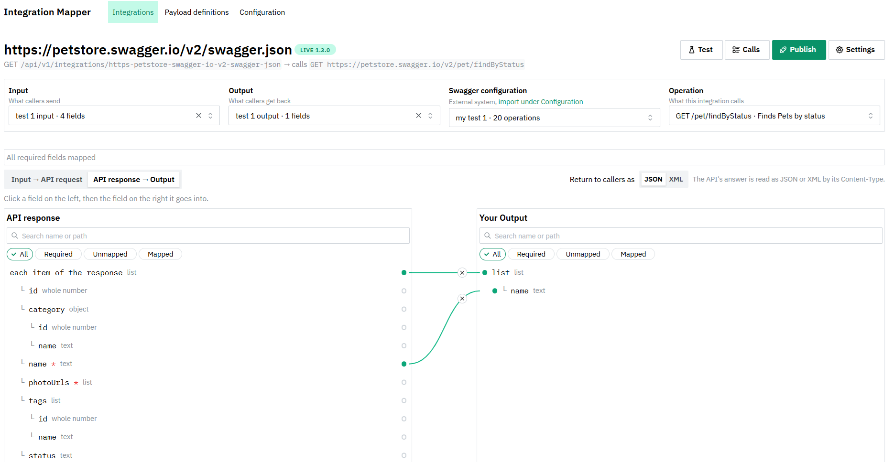
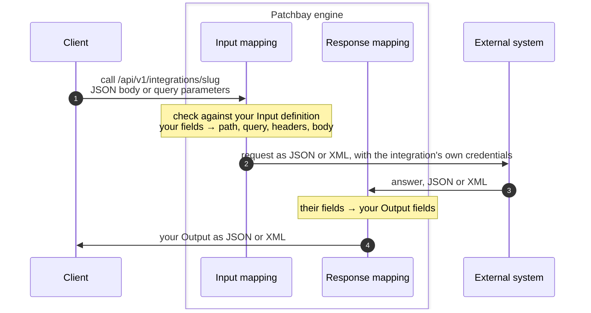

<p align="center"></p>

<h1 align="center">Patchbay</h1>

<p align="center"><b>Draw lines between two APIs. Get a live endpoint.</b></p>

<p align="center">Free and open source under the <a href="LICENSE">Apache License 2.0</a>. Docker image: <a href="https://hub.docker.com/r/krixerx/patchbay"><code>krixerx/patchbay</code></a></p>

Connect your own data model to an external REST or SOAP API without writing code. Import the API's OpenAPI (Swagger) or WSDL file, draw lines from your fields to theirs in the browser, and press **Publish**. The result is a live, versioned REST endpoint that callers can use, served by the same container.



The name comes from the patch bay of a studio or server room: a panel where any output is connected to any input with a short cable, without rebuilding anything behind it.

## Why use it

Most integration work is the same small job over and over: take what a caller sends, reshape it into what another system expects, call it, and reshape the answer back. Usually that means a new service, a mapping class, tests, a deployment and a change request every time a field moves. Here it is a board you edit and a button you press.

- **No code to keep alive.** The mapping is plain JSON in a folder. The engine turns it into Apache Camel routes and DataSonnet scripts when it starts or when you publish, so there is nothing generated to maintain.
- **Your model stays yours.** Callers see your field names and shapes, not the vendor's. When the vendor changes, you move a line, not your callers.
- **Try before you publish.** **Test** runs a sample through exactly the code a live call uses, against a mock built from the contract or the real system, and shows each step: what the caller sent, the request that went out, the answer, and your Output.
- **Safe changes.** Every publish is an immutable version. Links that can't work are shown in red and block publishing. Any earlier version can be made live again with one click, without a restart.
- **REST or SOAP.** Import an OpenAPI or Swagger file for a REST API, or a WSDL 1.1 contract (with its XSD files) for a SOAP service. A SOAP operation is mapped on the same board and published as an ordinary REST endpoint: callers send JSON, and Patchbay writes the SOAP 1.1 or 1.2 envelope with the right namespaces, reads the answer, and turns a SOAP fault into a JSON error.
- **JSON or XML.** Send the request to the external system as JSON or XML and return JSON or XML to callers, with one switch per direction. XML answers are read automatically.
- **See what happened.** **Calls** shows the last live calls step by step, including where a failed one stopped.
- **Callers get documentation.** Every live integration appears in an OpenAPI document at `/api/openapi.json`, ready for Swagger UI, code generators, or for another integration to call.
- **One small container.** No database, no message broker. Configuration is files you can keep in Git.

## How a call flows



1. **The client calls the integration** with the same HTTP method as the external operation: a JSON body for POST, PUT and PATCH, query parameters for GET and DELETE. The engine checks the call against your Input definition and answers `400` with every problem listed if it doesn't fit. Then your links build the external request: path parameters, query parameters, headers and body. Fields the caller did not send are left out.
2. **The request goes out** as JSON or XML. The caller's own headers never reach the external system; the integration adds its own credentials.
3. **The external system answers** in JSON or XML. If it answers with an error, the caller gets the same status and body; if it is too slow or unreachable, the caller gets `504` or `502`.
4. **The caller gets your Output.** Your response links turn the answer into your Output, list by list and field by field, and the caller gets it as JSON or XML. The call appears under **Calls** on the board.

## What you need

| To | Install |
|---|---|
| Run it with Docker | Docker (Docker Desktop on Windows and macOS) |
| Build and run it without Docker | Java 21 or newer, Maven 3.9 or newer, Node.js 24 with npm |

No database or other service is needed. Everything is stored as JSON files in one folder.

## Run it with Docker

The image is public on Docker Hub, for amd64 and arm64 (for example Apple silicon or AWS Graviton). Pulling it needs no Docker Hub account.

```bash
docker run -p 8080:8080 -v mapper-config:/config krixerx/patchbay
```

`latest` is the newest release. Pin a version for anything that should not change under you, for example `krixerx/patchbay:0.1.0`; the tags are listed on [Docker Hub](https://hub.docker.com/r/krixerx/patchbay/tags).

This publishes the port on every address of your computer, which is fine for trying Patchbay on a laptop. Anywhere else, follow [Run it inside an internal network](#run-it-inside-an-internal-network).

Open **http://localhost:8080** and create the admin login with the setup code from `docker logs` (see [Admin login](#admin-login)). Your work is saved in the named volume `mapper-config` and survives restarts and new images. To use a folder on your computer instead, mount it (`-v ./mapper-config:/config`); on Linux create it first and give it to the container user: `mkdir mapper-config && sudo chown 10001 mapper-config`.

With variables (see the table below):

```bash
docker run -p 8080:8080 -v mapper-config:/config \
  -e MAPPER_ADMIN_USER=admin -e MAPPER_ADMIN_PASSWORD=choose-a-long-password \
  -e INBOUND_API_KEY=choose-a-long-random-value \
  -e MAPPER_SECRET_CREATE_USER=your-gorest-token \
  krixerx/patchbay
```

To build the image yourself from this repository instead:

```bash
cd engine
docker build -t patchbay .
docker run -p 8080:8080 -v mapper-config:/config patchbay
```

## Admin login

The console and the admin API (everything under `/admin`) need the admin login: a user name and password that the browser asks for with its own login dialog. Scripts send it as HTTP Basic (`curl -u admin:...`). Integration callers don't use it; they use `INBOUND_API_KEY`.

- **First start:** with no login set, the engine writes a one-time setup code to its log, for example `Create it with setup code ABCD-EFGH-...`. Open the console, enter the code and choose the user name and a password of at least 12 characters. Until then only the setup page answers. Do this right after the first start: anyone who can read the engine's log could otherwise do it before you. The code works once and changes at every restart.
- **Stored:** the user name and a PBKDF2 hash of the password go to `<config>/secrets/console/login.json`, never the password itself.
- **From the environment instead:** set both `MAPPER_ADMIN_USER` and `MAPPER_ADMIN_PASSWORD`. Then there is no setup page, and the file is ignored. Setting only one of them stops the engine at start.
- **Forgot the password:** delete `<config>/secrets/console/login.json` and restart; a new setup code appears in the log.
- Browsers keep the login until they are closed; there is no logout button. Failed logins are written to the log.

## Run it inside an internal network

Patchbay is meant to run inside an internal network, such as a Docker network shared only with the services that call it. It is not built to face the internet. The console and the admin API can change every integration and its outbound credentials, the call log holds real payloads, and the engine itself has no TLS. Keep it this way:

- **Don't publish the port to the outside.** Callers in the same Docker network reach it by service name (`http://patchbay:8080`) without any `-p`. If people need the console from their own computers, publish it only on the host's loopback address (`-p 127.0.0.1:8080:8080`), or put a reverse proxy with TLS and its own access control in front of it.
- **Let only the services that need it in.** Put Patchbay in its own network with its callers, not in a network shared with unrelated containers.
- **Set `INBOUND_API_KEY`** unless every container that can reach the port is trusted. Without it, any of them can call every integration with its stored credentials. The console and the admin API are behind the [admin login](#admin-login) either way.
- **Use TLS when the console is reached over a network.** The admin login is HTTP Basic, so without TLS the password travels readable. A reverse proxy in front of Patchbay can add TLS. If it passes the browser's host name on unchanged (`Host`), nothing else is needed. If it changes the host name or port, let it send `X-Forwarded-Host` and `X-Forwarded-Proto` and set `SERVER_FORWARD_HEADERS_STRATEGY=native`, so Patchbay accepts the console's changes from the proxy's address.

```bash
docker network create patchbay-net
docker run -d --name patchbay --network patchbay-net \
  -p 127.0.0.1:8080:8080 -v mapper-config:/config \
  -e INBOUND_API_KEY=choose-a-long-random-value \
  krixerx/patchbay
docker logs patchbay   # the setup code for the admin login, on the first start
# a caller in the same network reaches it by name (the OpenAPI document needs no key)
docker run --rm --network patchbay-net curlimages/curl http://patchbay:8080/api/openapi.json
```

## Run it without Docker

```bash
cd engine/console
npm install
npm run build          # builds the console into engine/src/main/resources/static
cd ..
mvn clean package      # runs the tests and builds target/engine-0.0.1-SNAPSHOT.jar
java -jar target/engine-0.0.1-SNAPSHOT.jar --mapper.config-dir=config
```

Open **http://localhost:8080** and create the admin login with the setup code the engine printed (see [Admin login](#admin-login)). `config/` in the repository has three published examples that call the public [FakeRESTApi](https://fakerestapi.azurewebsites.net/index.html); use another folder to start empty (`--mapper.config-dir=my-config`, created on the first save).

Working on the console with hot reload: keep the engine running, then in `engine/console` run `npm run dev` and open http://localhost:5173 (API calls go to the engine on 8080).

Tests: `mvn test` in `engine/` (no internet needed) and `npm test` in `engine/console/`.

## Variables

None are required. Set them as environment variables (`-e` with Docker), or for the first three also as a command-line option of the jar.

| Variable | Default | What it does |
|---|---|---|
| `MAPPER_CONFIGDIR` (option `--mapper.config-dir`) | `config` (in Docker: `/config`) | Folder with all configuration: payload definitions, contracts, integrations, versions and secrets. |
| `MAPPER_IMPORT_DIR` (option `--mapper.import-dir`) | not set | A folder of packages (ZIPs made with **Export**) to import at every start, in file-name order, before anything is served. An integration with no live version here then gets the version that was live where its package came from. A package with problems or a version that can't go live (missing secret or base URL) is logged and skipped. Each start imports again: payload definitions, Swagger configurations and drafts from the folder replace what was changed in the console, while the live version chosen here is kept. Connections and secrets still come from the variables below. |
| `SERVER_PORT` (option `--server.port`) | `8080` | Port of the console, the admin API and the published integrations. |
| `MAPPER_OUTBOUNDTIMEOUTMS` (option `--mapper.outbound-timeout-ms`) | `10000` | How long a call to an external system may take, in milliseconds; after that the caller gets `504`. It applies separately to getting a pooled connection, connecting and waiting for the answer, so a call can take up to three times this in the worst case. |
| `MAPPER_ADMIN_USER`, `MAPPER_ADMIN_PASSWORD` | not set | The admin login of the console and the admin API. Set both or neither: when both are set they win over the login created on the setup page. Not set: the first start shows the setup page (see [Admin login](#admin-login)). |
| `INBOUND_API_KEY` | not set | The key of integration callers. When set, every request must send this value in the `X-API-Key` header, otherwise `401`: published integrations and any other path. Open without it: the console and the admin API (they have the admin login instead), the OpenAPI documents (`/api/openapi.json`, `/api/openapi/<slug>.json`) and the health probes. Not set: integration calls are not checked, which is meant for a closed Docker network only. |
| `MAPPER_MAXBLOBBYTES` (option `--mapper.max-blob-bytes`) | `52428800` (50 MiB) | The largest file a caller may send (larger: `413`) or an external system may answer (larger: `502`). |
| `MAPPER_MAXBODYBYTES` (option `--mapper.max-body-bytes`) | `10485760` (10 MiB) | The largest request body other than files, for example a JSON Input, and of every admin call. Files sent as base64 inside JSON get room on top of it, and so do a contract's ZIP (20 MB) and a Test call's file. A package import may be up to 50 MB. A larger body gets `413`, also when it is sent chunked without a length. |
| `MAPPER_URL_<ID>` | not set | The base URL of a Swagger configuration's connection in this environment, for example `MAPPER_URL_FAKE_REST_API` for the configuration `fake-rest-api` (id in capitals, other characters as `_`). It wins over the address set with **Connection** under Configuration. A base URL may carry a query of its own (for example `?sap-client=100`): the operation path goes before it, and it is sent with every call ahead of the mapped query parameters. |
| `MAPPER_HEADER_<ID>_<NAME>` | not set | The value of a header that a connection sends on every call, for example `MAPPER_HEADER_GOREST_X_CLIENT_ID` for header `X-Client-Id` of connection `gorest` (capitals, other characters as `_`). It wins over the value set with **Connection** under Configuration. |
| `MAPPER_SECRET_<SLUG>` | not set | The token or API key an integration sends to its external system, for example `MAPPER_SECRET_CREATE_USER` for the integration `create-user` (slug in capitals, other characters as `_`). It wins over a secret typed on the integration's Settings page. |
| `MAPPER_CALL_LOG` | `on` | `on` keeps the last 100 live calls of each integration in memory, with what the caller sent, the request sent out, the answer and the mapped output, shown under **Calls** on the board. `off` keeps none of that; each call still writes one line without data to the log. |

## Health

`/actuator/health/readiness` answers `200` once every integration is loaded after a start, `/actuator/health/liveness` while the engine runs. Both are open without `INBOUND_API_KEY`; no other actuator endpoint is published. The Docker image's `HEALTHCHECK` uses readiness. Every answer carries an `X-Request-Id` (the caller's, when it sent a short plain one); a call that fails inside Patchbay answers with that id and logs the cause under it.

## Security in short

- Run Patchbay inside an internal network and never publish its port to the internet; see [Run it inside an internal network](#run-it-inside-an-internal-network). The engine speaks plain HTTP, so the admin password, the key and payloads travel unencrypted unless a reverse proxy adds TLS.
- The console and the admin API need the [admin login](#admin-login). Changes are accepted only as JSON (a ZIP for package import) and only from the console's own address, so a web page open in the same browser can't make them with the browser's saved login. Answers carry a Content-Security-Policy and can't be shown in a frame.
- Without `INBOUND_API_KEY`, anyone who can reach the port can call every integration, which uses the stored credentials of the external systems. Set it whenever the port is reachable from outside a closed network.
- Every base URL must be a plain `http://` or `https://` address, whatever it comes from (a connection, `MAPPER_URL_<ID>`, or an older version file); anything else stops that integration from going live. Whoever prepares and imports packages checks the addresses in them: a package may carry older versions with a literal base URL, and the import lists those.
- Secrets typed on a Settings page are stored **unencrypted** in `<config>/secrets/<slug>.json`, readable only by the engine's user on Linux and in Docker (Windows does not enforce it). The same goes for secret connection headers in `<config>/secrets/connections/<id>.json`. Use `MAPPER_SECRET_<SLUG>` and `MAPPER_HEADER_<ID>_<NAME>` to keep them out of the folder.
- Headers that callers send (including `X-API-Key` and `Authorization`) never reach the external system.
- The OpenAPI documents under `/api/openapi` can be read without `INBOUND_API_KEY`. They show integration names and field shapes, never data or secrets.
- An imported Swagger or OpenAPI file may refer (`$ref`) only to places inside itself, or, when it was imported by URL, to absolute addresses on the same host. Any other reference refuses the import, so a file can't make the engine read its own files or call other hosts. A WSDL's XSD files are fetched only from the WSDL's own address, without redirects.
- The call log holds real payloads, which may include personal data, and anyone with console access can see them. Auth values are shown as `***`. Set `MAPPER_CALL_LOG=off` where that is not acceptable.

## How to build an integration

1. **Configuration:** import the external system's Swagger, OpenAPI or WSDL file (upload or URL; a WSDL with separate XSD files as a ZIP). Every integration can use it. A SOAP service's operations are listed as SOAP `<port>/<operation>` and are published as ordinary REST endpoints; `engine/README.md` describes how. Its **Connection** holds the base URL in this environment, taken from the file when it has an absolute server address.
2. **Payload definitions** (optional): describe what your callers send and get back, by hand or from a pasted JSON sample.
3. **Integrations → New integration**, then on its board pick the Input, the Output, the Swagger or WSDL configuration and the operation. Leave Input or Output empty to have it created from the operation, already linked.
4. **Map:** click a field on the left, then the field on the right it goes into; a line connects them. Red lines can't be published; amber warnings can. **Test** runs a sample through the same code as a live call. The JSON/XML switch next to the tabs sets how the request goes out and what callers get back.
5. **Publish:** shows the live URL and a ready `curl` command. Earlier versions can be made active again.
6. **Calls:** every live call, step by step, with where it stopped if it failed. `docker logs` shows one line per call.
7. **OpenAPI:** `http://localhost:8080/api/openapi.json` describes every live integration, `/api/openapi/<slug>.json` one of them (linked from the Integrations list and the Publish dialog). Give it to callers, or import it under Configuration so one integration can call another; then set that integration's base URL to the engine itself and, if `INBOUND_API_KEY` is set, its auth to an API key in the `X-API-Key` header.

Authentication (bearer token, Basic user and password, or API key) and the secret are on the integration's **Settings** page; the base URL belongs to the Swagger or WSDL configuration's connection.

## Environments

Integrations and their versions never contain an address or a secret: they name a connection, and each environment sets that connection's base URL (`MAPPER_URL_<ID>` or **Connection** under Configuration) and the integrations' secrets (`MAPPER_SECRET_<SLUG>` or Settings). So the same version file can run in DEV, TEST and LIVE. The folders `connections/` and `secrets/` in the configuration folder belong to their environment and are not copied along. Integrations published before connections existed keep their literal base URL in those older version files until they are published again.

To move integrations, tick them on the Integrations list and click **Export**: you get a ZIP with their drafts, all their versions, and the payload definitions and Swagger or WSDL configurations they use (a WSDL with its XSD files). In the other environment, **Import** stores it and shows per integration what that environment still needs (a base URL, a secret, header values). Nothing goes live until you click **Make active** there.

## Releases

Pushing a tag such as `v0.1.0` runs `.github/workflows/release.yml`: the engine and console tests, a Trivy scan of the image, and then the push of `krixerx/patchbay:0.1.0`, `:0.1` and `:latest` for amd64 and arm64. A tag with a suffix (`v0.2.0-rc.1`) gets only its own tag, not `latest`. The workflow needs the repository secrets `DOCKERHUB_USERNAME` and `DOCKERHUB_TOKEN` (a Docker Hub access token with Read & Write).

```bash
git tag v0.1.0
git push origin v0.1.0
```

## License

Patchbay is free and open source under the [Apache License 2.0](LICENSE). You may use, change and share it, also commercially, as long as you keep the license and the [NOTICE](NOTICE) file. Every dependency is under an open source license compatible with Apache-2.0 (spec NFR-009). Contributions are accepted under the same license.

## More

- `engine/README.md`: file formats, admin calls, lists, error shapes, known behavior.
- `docs/slice-plan.md`: the plan and every design decision (D-…, R-…); `docs/integration-mapper-spec.md`: the long-term spec.
- `DESIGN.md`: the console's design tokens and rules.
