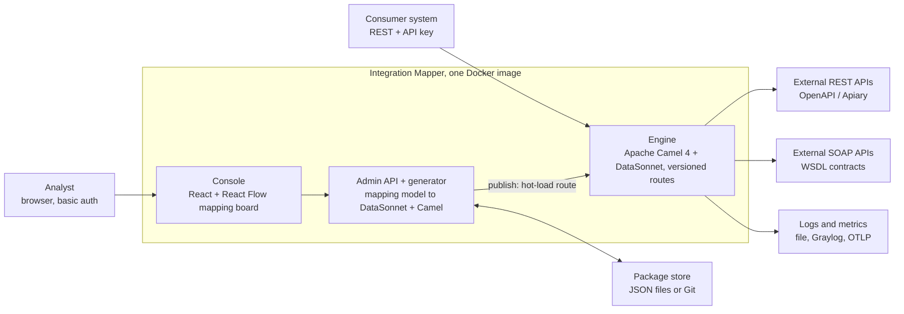

# Integration Mapper — Product & Architecture Spec

Oct 20, 2026 · @Erki

## How to read this document

This spec is written to be fed directly to AI coding agents and to humans: every requirement has a stable ID, every decision is explicit, and every term is defined once.

**Conventions**

- Requirement IDs: `FR-xxx` functional, `NFR-xxx` non-functional, `ADR-xxx` architecture decision, `OQ-xxx` open question.
- Keywords MUST, SHOULD, MAY follow RFC 2119.
- Working product name: **Integration Mapper** (rename freely; search-and-replace safe).
- When an agent implements a feature, it MUST reference the requirement ID in commit messages and tests.
- Anything not stated here is out of scope until added as a requirement.

**Glossary**

| Term | Meaning |
| --- | --- |
| Contract | An imported OpenAPI/Swagger, API Blueprint (Apiary) or WSDL file describing an external service |
| Operation | One callable endpoint in a contract: REST path + method, or SOAP operation |
| Entity | An analyst-defined internal data structure ("table"), e.g. `person` with typed fields |
| Mapping | A set of field links between an entity and an operation's request or response, plus transformations and conditions |
| Request mapping | Entity → external request (left to right) |
| Response mapping | External response → entity (right to left) |
| Transformation | A function applied to a value on a link, e.g. string → number |
| Condition (determinant) | A rule deciding whether a link, block or whole call is applied, e.g. `age < 18 → skip` |
| Integration | Entity + operation + request mapping + response mapping + security + exposed endpoint |
| Package | A versioned, portable bundle of integrations and their contracts |
| Publish | Turning a package version into live Camel routes |
| Console | The Angular/React web UI |
| Engine | The Apache Camel runtime that executes published integrations |

## Product vision, goals and non-goals

Integration Mapper lets an analyst connect two systems without writing code: import the provider's contract, draw lines between fields, publish, and the engine exposes a working, versioned API.

**Goals**

1. Import REST (OpenAPI 2/3, API Blueprint) and SOAP (WSDL 1.1/2.0) contracts and browse their operations.
2. Define internal entities (tables + typed fields) in the console.
3. Map fields visually by drag-and-drop in both directions, with transformations and conditions.
4. Publish a mapping as a versioned Camel route exposed over REST.
5. Promote configuration DEV → TEST → PROD as files, through Git or a single export bundle.
6. Run fully headless in production (console off, configuration from the container).
7. 100% open source; one public Docker image on Docker Hub.

**Non-goals for v1**

- Protocols other than REST and SOAP (Kafka, AMQP, gRPC, GraphQL, SFTP come later; the design must not block them).
- Orchestration of many calls in one flow (BPMN-style). Decided (OQ-001): one inbound call → exactly one outbound operation from the contract.
- Multi-tenant SaaS, fine-grained RBAC, SSO in the console.
- Storing business data; the engine is stateless pass-through.

## Market scan: build only what is missing

Before any implementation, the team MUST check which parts already exist as open-source products and reuse or contribute to them instead of rebuilding. A first scan shows the Camel ecosystem already covers route design; the gap is contract-first, analyst-level field mapping published to a running engine.

**Rule (ADR-005):** every module in Functional requirements gets a "build / reuse / contribute" decision recorded before coding starts.

| Product | What it already does | Licence | Overlap with us | Decision to make |
| --- | --- | --- | --- | --- |
| [Kaoto](https://docs.redhat.com/en/documentation/red_hat_build_of_apache_camel/4.14/html/kaoto_camel_designer/overview-of-kaoto) | Low-code / no-code visual designer for Camel routes, aimed at Camel developers; includes a data-mapper UI | Apache-2.0 | High for mapping UI | Evaluate reusing its data-mapper component or contributing DataSonnet support |
| [Apache Camel Karavan](https://www.github.com/apache/camel-karavan) | Low-code Camel platform: visual design, OpenAPI → REST DSL, Git as source of truth, deploy to Kubernetes/OpenShift | Apache-2.0 | High for route design + Git storage | Compare: Karavan builds one microservice per integration; we hot-load into one running engine |
| Apache NiFi | Visual dataflow engine with processors for HTTP and many formats | Apache-2.0 | Medium | Not contract-first; heavier runtime |
| Node-RED | Flow-based low-code wiring, large community | Apache-2.0 | Medium | No contract import or typed field mapping |
| WSO2 Micro Integrator / Integration Studio | Integration runtime with graphical data mapper, REST + SOAP | Apache-2.0 | High | Check current licensing and tooling status |
| n8n | Workflow automation with HTTP nodes | Sustainable Use (not OSI open source) | Medium | Excluded by the open-source requirement |
| MuleSoft, Boomi, Workato | Commercial iPaaS with visual mappers (DataWeave etc.) | Proprietary | High | UX reference only |

Rows without a link are from prior knowledge and must be verified in the scan.

**Our intended differentiators (verify they are real gaps)**

1. Contract-first: import OpenAPI / API Blueprint / WSDL and get a ready field tree, no route design.
2. Analyst-level two-column mapping board with transformations and conditions, no Camel knowledge needed.
3. Publish into a running engine with versions and rollback, no build or image per integration.
4. One container dropped into Docker Compose / Kubernetes / OpenShift, ActiveMQ-style.

**Product name**

"EasyLink" is not recommended: the name is already used in the same field. EasyLink Services was a cloud B2B messaging and business-integration provider acquired by OpenText in 2012 ([CB Insights](https://www.cbinsights.com/company/easylink-services-corporation)); Siemens sells an EasyLink lab data-connectivity system ([Siemens](https://www.healthcare.siemens.nl/diagnostics-it/productivity/easylink-data-mgt-sys)); a Python package called easylink exists ([docs](https://easylink.readthedocs.io)). Trademark and search-visibility risk is high.

Candidate names to check (Docker Hub, GitHub, npm, Maven Central, trademark databases, .io/.dev domains): **MapBridge**, **ContractLink**, **LinkBoard**, **Mappa**, **WireMap**. A variant such as "EasyLink Mapper" lowers but does not remove the conflict.

## Personas and core user journeys

Three personas cover v1: the analyst builds, the administrator runs, the consuming system calls.

| Persona | Uses | Main need |
| --- | --- | --- |
| Analyst | Console | Build and change integrations without code |
| Administrator / DevOps | Docker env, Git, CI | Deploy, secure, promote, observe; disable the console in PROD |
| Consumer system (e.g. Spring Boot app) | Engine REST API | Call a stable, versioned endpoint with a simple JSON payload |

**Journey J1 — build a new integration (analyst)**

1. Log in to the console.
2. Create or pick an entity, e.g. `person` (firstName, lastName, birthDate, age, personalCode).
3. Import a contract (upload file, paste URL, or pick one provided by the container).
4. Pick an operation, e.g. `POST /persons`.
5. On the mapping board, drag entity fields (left) to request fields (right).
6. Switch to the response tab and drag response fields (right) back to entity fields (left).
7. Add transformations on links and conditions on links or blocks.
8. Test with a sample payload (dry run against a mock or the real endpoint).
9. Save as draft, then publish → version `1.0.0` becomes live at `/api/v1/integrations/{slug}`.

**Journey J2 — change a live integration (analyst)**

1. Open the published version; the console creates a new draft from it.
2. Edit mappings; the diff against the live version is shown.
3. Publish as a new version (`1.1.0`), or as a hot-fix replacing the current version in place (see Publishing).

**Journey J3 — promote DEV → TEST (administrator)**

1. Export the package (or commit from the console to Git).
2. In TEST, the container loads the package from a mounted volume or Git ref.
3. Environment-specific values (base URLs, API keys) come from env variables, never from the package.

## Functional requirements

Requirements are grouped by module; priority uses MoSCoW (M = must for v1).

| ID | Module | Requirement | Priority |
| --- | --- | --- | --- |
| FR-001 | Contracts | Import OpenAPI 2.0 / 3.0 / 3.1 (JSON or YAML) by file upload or URL | M |
| FR-002 | Contracts | Import WSDL 1.1 (and 2.0 where feasible) including referenced XSDs, as file, ZIP or URL | M |
| FR-003 | Contracts | Import API Blueprint (Apiary) by converting it to OpenAPI on import (e.g. apib2swagger) | S |
| FR-004 | Contracts | Parse contracts into a normalized operation model: name, protocol, method/SOAP action, path, request schema, response schemas per status, faults | M |
| FR-005 | Contracts | Keep the original contract file unchanged alongside the normalized model | M |
| FR-006 | Contracts | Re-import a newer contract version and show which mapped fields were removed or changed | S |
| FR-007 | Contracts | Load contracts from a container directory at startup (`/config/contracts`) | M |
| FR-010 | Entities | Create entities ("tables") with fields: name, type (string, integer, decimal, boolean, date, datetime, object, array), required, default, description | M |
| FR-011 | Entities | Nested objects and arrays inside an entity | M |
| FR-012 | Entities | Import an entity from a JSON sample or JSON Schema | S |
| FR-013 | Entities | Import entities from an existing database schema: connect over JDBC (PostgreSQL, MySQL/MariaDB, Oracle, MS SQL Server) with a read-only user, or upload a SQL DDL file; pick tables and columns to import | M |
| FR-014 | Entities | DB import maps column types to entity types (e.g. VARCHAR → string, NUMERIC → decimal, TIMESTAMP → datetime), NOT NULL → required, keeps column comments as descriptions, and offers foreign keys as nested objects; DB credentials are used once and never stored in the package | M |
| FR-020 | Mapping board | Two-column board: entity tree left, operation tree right, expand/collapse, search per side | M |
| FR-021 | Mapping board | Drag a line from left to right in the Request tab, right to left in the Response tab | M |
| FR-022 | Mapping board | Show type mismatch on a link and offer matching transformations | M |
| FR-023 | Mapping board | Attach a transformation chain and a condition to any link | M |
| FR-024 | Mapping board | Constants and expressions as sources (e.g. fixed country code, `now()`) | M |
| FR-025 | Mapping board | Array-to-array mapping with per-item context | M |
| FR-026 | Mapping board | Show the generated DataSonnet script read-only; expert mode MAY allow editing it | S |
| FR-027 | Mapping board | Highlight required target fields that are not mapped | M |
| FR-028 | Mapping board | Auto-map by identical or similar field names, as a suggestion the analyst confirms | C |
| FR-030 | Testing | Dry run: input sample → show generated request, optionally call the endpoint, show the mapped response | M |
| FR-031 | Testing | Built-in mock of the external operation generated from its schema | S |
| FR-040 | Publishing | Publish a draft as an immutable semantic version | M |
| FR-041 | Publishing | Edit a published version by creating a draft from it; republish as new version or hot-fix | M |
| FR-042 | Publishing | Activate, deactivate and roll back a version without restart | M |
| FR-043 | Publishing | Several versions of one integration live at once under versioned paths | M |
| FR-050 | Security | Outbound auth per contract: API key (header/query), Basic, Bearer token, OAuth2 client credentials, mTLS | M (API key) / S (others) |
| FR-051 | Security | Inbound auth for consumers calling the engine: API key per consumer | M |
| FR-052 | Security | Secrets set in console or env variables; env always wins | M |
| FR-060 | Config | Export and import a package as a ZIP; optional Git sync | M |
| FR-061 | Config | Console can be disabled entirely; engine still loads config from files | M |
| FR-070 | Logging | Logging destinations configurable in container: console, file, GELF/Graylog, others | M |
| FR-071 | Logging | Per-call audit record: integration, version, correlation ID, status, duration, masked payload | M |

## Architecture

The console and admin API exist only to produce files; the engine reads those files and runs routes, so it works with the console switched off.



In PROD only the engine port is exposed; the package is mounted read-only and the console box disappears.

**Containers and responsibilities**

| Container | Responsibility | Talks to |
| --- | --- | --- |
| Console (SPA) | Contract import, entity editor, mapping board, test runner, publish UI | Admin API (REST/JSON) |
| Admin API | CRUD on package files, contract parsing, validation, generation, publish/rollback | Package store, Engine (in-process) |
| Generator | Mapping model → DataSonnet; integration → Camel YAML route | — (library) |
| Engine | Inbound REST, request mapping, outbound REST/SOAP with security, response mapping, error handling | External systems, logs |
| Package store | Source of truth for contracts, entities, mappings, versions | — |
| Optional DB | Users, audit log, search index | Admin API, Engine |

**Request flow at runtime**

1. Consumer calls `POST /api/v1/integrations/register-person` with `X-API-Key` and the full `person` payload as JSON or XML.
2. Engine authenticates the key, assigns a correlation ID.
3. Call condition evaluated; if false, return the configured response (e.g. `422` with reason).
4. `request.ds` maps `person` → external request; outbound security applied; REST or SOAP call made.
5. `response.ds` maps the external response (or fault) → entity JSON.
6. Errors mapped to a uniform problem+json body; audit record written.

## Technology decisions

Recommendation: **React + React Flow (`@xyflow/react`)** for the console, **Spring Boot 3 + Apache Camel 4 + DataSonnet** for the engine, all in one container image.

**ADR-001 — Frontend: React, not Angular**

- The mapping board is the product's core, so the frontend choice follows the best mapping library.
- React Flow is the most widely adopted open-source node/edge editor, MIT licensed, with any React component usable as a node ([xyflow](https://github.com/xyflow/xyflow), [npm](https://www.npmjs.com/package/@xyflow/react)). Each side of the board is one custom node; each field row carries a connection handle; links are edges.
- Angular options exist (e.g. Foblex Flow, ngx-vflow) but have far smaller communities and fewer examples; choose Angular only if the team is Angular-only.
- Supporting libraries: TypeScript, Vite, TanStack Query, a tree component for large schemas with virtualization (e.g. react-arborist), Monaco Editor for the expert DataSonnet view, an open-source UI kit (MUI or Mantine).
- Reference worth studying: Kaoto, the Apache Camel visual designer (React, Apache-2.0), which includes a data-mapper UI.

**ADR-002 — Engine stack**

| Concern | Choice | Licence |
| --- | --- | --- |
| Runtime | Java 21, Spring Boot 3, Apache Camel 4.x (`camel-spring-boot`) | Apache-2.0 |
| Inbound REST | Camel REST DSL on `platform-http` | Apache-2.0 |
| Outbound REST | `camel-http` / `camel-rest-openapi` | Apache-2.0 |
| Outbound SOAP | `camel-cxf-soap` (Apache CXF) | Apache-2.0 |
| Mapping language | `camel-datasonnet` (in Camel since 3.7) | Apache-2.0 |
| OpenAPI parsing | swagger-parser | Apache-2.0 |
| WSDL/XSD parsing | Apache CXF tooling or Membrane SOA Model | Apache-2.0 |
| API Blueprint | apib2swagger (convert on import) | MIT |
| Route format | Generated Camel YAML DSL, loaded at runtime via `RoutesLoader` | — |
| Optional DB | PostgreSQL or embedded H2 (index, audit) via Flyway | PostgreSQL / MPL-2.0 + EPL |

**ADR-003 — One image, two roles**

One Spring Boot app contains the engine, the admin API and the built console as static files. `CONSOLE_ENABLED=false` removes the console and admin API from the HTTP stack; the engine keeps serving. Admins may also run console and engine as separate containers from the same image (`MODE=engine|console|all`).

## Configuration storage and environment promotion

Decision (ADR-004, resolves OQ-003): **configuration is plain JSON files — one file per configuration item, linked from one main JSON file.** This follows the simple approach of [opencode's `opencode.json`](https://opencode.ai/docs/config/) (a `$schema` key, `{env:VAR}` and `{file:path}` substitution), split into many files so each service can be reviewed, copied and promoted on its own. Files are the source of truth; promotion DEV → TEST → PROD is copying the folder (or a Git merge); a database is optional and only an index.

**Why files over a database**

- Promotion = copy a folder, mount a volume, or pull a Git tag; no DB dump/restore or ID clashes.
- Every change is visible in a pull-request diff; rollback is `git revert`.
- Contracts already are files (YAML, JSON, WSDL); keeping them as files avoids lossy round trips.
- The engine can start in PROD with no database and no console.

**Package layout (one Git repo or one ZIP)**

```
config/
  mapper.json                         # main file: links every other file
  entities/
    person.json
  contracts/
    gdb-diplomatic-id.json            # contract metadata + operations cache
    gdb-diplomatic-id.openapi.yaml    # original file, untouched (or .wsdl/.xsd)
  services/
    register-person.json              # one integration: mappings, conditions, security, active version
    register-person.versions/
      1.0.0.json                      # immutable snapshot of a published version
      1.1.0.json
  security/
    gdb-api-key.json                  # outbound profile, values via {env:...}
  consumers.json                      # inbound API keys (hashed)
```

**Main file `mapper.json`**

```json
{
  "$schema": "https://<project-site>/schema/main.json",
  "name": "citizen-integrations",
  "version": "1.4.0",
  "entities":  ["entities/person.json"],
  "contracts": ["contracts/gdb-diplomatic-id.json"],
  "services":  ["services/register-person.json"],
  "security":  ["security/gdb-api-key.json"],
  "consumers": "consumers.json",
  "settings": {
    "logLevel": "{env:LOG_LEVEL}",
    "baseUrls": { "gdb": "{env:GDB_BASE_URL}" }
  }
}
```

**Service file `services/register-person.json`**

```json
{
  "$schema": "https://<project-site>/schema/service.json",
  "id": "register-person",
  "entity": "person",
  "contract": "gdb-diplomatic-id",
  "operationId": "createDiplomaticId",
  "inbound": { "path": "/register-person", "formats": ["json", "xml"] },
  "security": "gdb-api-key",
  "activeVersion": "1.1.0",
  "request":  { "links": [ { "from": "firstName", "to": "APPLICANT.givenName" } ] },
  "response": { "links": [ { "from": "ID", "to": "diplomaticId" } ] },
  "callCondition": null
}
```

**Security file `security/gdb-api-key.json`**

```json
{
  "id": "gdb-api-key",
  "type": "apiKey",
  "in": "header",
  "name": "X-API-Key",
  "value": "{env:GDB_API_KEY}"
}
```

**Rules**

- One configuration item = one JSON file; the main file only lists paths (relative to itself). A file not listed in `mapper.json` is ignored.
- Every file has a `$schema` so editors (VS Code, IntelliJ) validate and autocomplete it; the engine validates against the same JSON Schemas on load and refuses invalid files with the file name and JSON path.
- Substitution like opencode: `{env:NAME}` reads an environment variable, `{file:path}` reads a file (e.g. a Docker secret at `/run/secrets/...`). Secrets and environment-specific URLs MUST only appear as substitutions, never as literal values.
- The console reads and writes exactly these files; hand-editing them is supported, and the console picks up changes on reload.
- DataSonnet scripts and Camel routes are generated from the JSON at load or publish time and are not stored as configuration.
- IDs are slugs, not database IDs, so they stay stable across environments; `CONFIG_FILE` env var points to another main file if needed.
- Optional database holds only rebuildable or runtime data: search index, users, audit log, call metrics.

## Mapping model: links, transformations and conditions

The console never edits DataSonnet directly: it edits a JSON mapping model, and a generator turns that model into a DataSonnet script. The model is the contract between frontend and backend.

**Mapping model (request direction, `person` → `POST /diplomatic-ids`)**

```json
{
  "schemaVersion": 1,
  "direction": "request",
  "source": { "kind": "entity", "ref": "person" },
  "target": { "kind": "operation", "contract": "gdb-diplomatic-id", "operationId": "createDiplomaticId", "part": "body" },
  "links": [
    { "id": "l1", "from": "firstName", "to": "APPLICANT.givenName" },
    { "id": "l2", "from": "ageText", "to": "APPLICANT.age",
      "transforms": [ { "fn": "toInteger" } ] },
    { "id": "l3", "from": "birthDate", "to": "APPLICANT.dateOfBirth",
      "transforms": [ { "fn": "formatDate", "args": { "from": "dd.MM.yyyy", "to": "yyyy-MM-dd" } } ] },
    { "id": "l4", "from": "guardianName", "to": "APPLICANT.guardian",
      "condition": { "field": "age", "op": "<", "value": 18 } },
    { "id": "l5", "const": "EE", "to": "APPLICATION.country" }
  ],
  "blockConditions": [
    { "target": "PASSPORT", "when": { "field": "hasPassport", "op": "==", "value": true } }
  ],
  "callCondition": null
}
```

**Generated DataSonnet (excerpt)**

```
/** DataSonnet
version=2.0
input payload application/json
output application/json
*/
{
  APPLICANT: {
    givenName: payload.firstName,
    age: std.parseInt(payload.ageText),
    [if payload.age < 18 then 'guardian']: payload.guardianName
  },
  APPLICATION: { country: 'EE' },
  [if payload.hasPassport == true then 'PASSPORT']: { }
}
```

A field whose computed name is `null` is omitted, which is how conditions skip a mapping without emitting empty values.

**Condition levels**

| Level | Effect when false | Example |
| --- | --- | --- |
| Link | Target field not written | Map guardian only if `age < 18` |
| Block | Whole target object or array not written | Send `PASSPORT` only if `hasPassport` |
| Call | External system not called; engine returns a configured response | Do not register applicants under 18 |

Conditions support `== != < <= > >= in notIn isEmpty isNotEmpty matches(regex)`, combined with `and` / `or` groups in a visual builder.

**Transformation catalogue (v1)**

| Group | Functions |
| --- | --- |
| Type | toString, toInteger, toDecimal, toBoolean |
| Text | trim, upper, lower, substring, replace, concat, split, padLeft |
| Date | formatDate, parseDate, now, addDays |
| Number | round, multiply, divide, defaultIfNull |
| Lookup | valueMap (e.g. `M→MALE`, `F→FEMALE`), defined in a reusable lookup table |
| Expert | custom DataSonnet expression on the link |

Transforms on one link form a chain, applied left to right. The board shows a small badge on each link with a transform or condition; clicking it opens the editor.

**SOAP**

SOAP bodies are mapped as XML through DataSonnet's `application/xml` support. The board shows the XSD-derived tree exactly like a JSON schema; the generator handles namespaces and the SOAP envelope.

## Publishing, versioning and route lifecycle

Publishing validates the mapping, generates DataSonnet and a Camel YAML route, writes an immutable version snapshot, and hot-loads the route into the running CamelContext with no restart.

**Publish pipeline**

1. Validate: the service JSON against its schema; required target fields mapped; types compatible after transforms; conditions reference existing fields.
2. Generate in memory the DataSonnet request and response scripts and a Camel route with a stable route ID `int-{slug}-v{major}`.
3. Compile check: DataSonnet scripts parsed; route parsed by Camel's loader.
4. Snapshot: write `services/{slug}.versions/{semver}.json` (immutable, with a SHA-256 of its content) and set `activeVersion` in the service file.
5. Load: add or replace only that route ID (never remove all routes), so other integrations keep running.
6. Smoke test (optional): run the saved test case; on failure, auto-rollback to the previous version.

**Versioning (semantic)**

| Change | New version | Path |
| --- | --- | --- |
| Breaking change to the inbound API (field removed, type changed) | major `2.0.0` | `/api/v2/integrations/{slug}` — v1 stays live in parallel |
| Compatible change (new optional field, new transform) | minor `1.1.0` | same `/api/v1/...`, replaces 1.0.x |
| Fix to a mapping with identical inbound API | patch `1.0.1` | same path, replaces in place |

**Editing a deployed version (FR-041)**

Published versions are immutable. "Edit" creates a draft copied from that version; the console shows a diff and suggests the version bump. The previous version stays available for one-click rollback.

**States**

| State | Meaning |
| --- | --- |
| Draft | Editable, not loaded in Camel |
| Published-active | Loaded and serving traffic |
| Published-inactive | Stored, can be activated or rolled back to |
| Deprecated | Serving, but responses carry a `Deprecation` header |
| Retired | Unloaded; kept in history |

**How consumers call the engine (Spring Boot ↔ Camel)**

Recommendation: **plain REST over HTTPS** for v1. It needs no shared library, works with Spring's `RestClient` or an OpenAPI-generated client, and the engine publishes an OpenAPI document for every active integration at `/api/openapi.json`. Consumers send the entire payload in one request, as JSON or XML (`Content-Type: application/json` or `application/xml`), shaped like the entity (e.g. a `person`). The response uses the format in the `Accept` header, defaulting to the request format; consumers never see the external system's format.

Later options, same routes with an added inbound adapter: asynchronous messaging (Kafka, ActiveMQ Artemis via JMS/AMQP) for fire-and-forget or high-volume calls, and gRPC for low-latency internal traffic.

## Security

Security has three surfaces: the console, inbound calls from consumers, and outbound calls to external systems; each is configured separately and every secret can come from the container environment.

**Console (ActiveMQ-style simple auth)**

- HTTP Basic or a login form backed by a users file (`/config/users.yaml`, bcrypt hashes) or env vars `CONSOLE_ADMIN_USER` / `CONSOLE_ADMIN_PASSWORD_HASH`.
- Two roles only: `viewer` (read) and `editor` (edit, publish).
- Exposure controlled by the administrator: `CONSOLE_ENABLED`, a separate `CONSOLE_PORT` (default 8081, engine 8080) so it can stay unpublished in Docker, and `CONSOLE_BIND_ADDRESS` (e.g. `127.0.0.1`).
- Optional later: OIDC (Keycloak) as an opt-in mode.

**Inbound (consumers → engine)**

- API key per consumer in header `X-API-Key`, stored hashed; keys scoped to integrations.
- Optional mTLS and IP allow-list. Rate limit per key (Camel throttle EIP).

**Outbound (engine → external systems)**

- Security profile per contract: `apiKey` (header or query, name from the contract's `securitySchemes`), `basic`, `bearer`, `oauth2-client-credentials` (token cached and refreshed), `mtls`, WS-Security UsernameToken for SOAP.
- Secret resolution order: env var / Docker secret file (`/run/secrets/...`) > secret set in console (encrypted at rest with `MASTER_KEY`) > none. Env always wins, so PROD never depends on console-entered secrets.
- Secrets are never written into packages, logs or test outputs; logs show `***`.
- TLS verification on by default; custom CA bundle via `/config/truststore`.

## Logging and observability

Logging uses SLF4J + Logback with destinations switched by one env variable; metrics and traces use open standards so any popular backend works.

| `LOG_OUTPUT` value | Destination | Library |
| --- | --- | --- |
| `console` (default) | stdout, for Docker / Kubernetes log collectors | Logback |
| `json` | stdout as JSON lines (ELK, Loki, Fluent Bit) | logstash-logback-encoder |
| `file` | Rolling text files in `/logs` (`LOG_FILE_MAX_SIZE`, `LOG_FILE_MAX_HISTORY`) | Logback |
| `gelf` | Graylog over UDP/TCP (`GELF_HOST`, `GELF_PORT`) | logback-gelf |
| `otlp` | OpenTelemetry collector (Grafana, Datadog, Elastic, etc.) | OpenTelemetry Java agent |

Several values may be combined, e.g. `LOG_OUTPUT=json,gelf`. `LOG_LEVEL` and `LOG_LEVEL_<package>` set levels.

**Per-call audit record (FR-071)**

Fields: timestamp, correlation ID (from `X-Correlation-Id` or generated), integration slug, version, consumer key ID, outbound URL (no query secrets), HTTP status, duration in ms, result (`ok`, `skipped-by-condition`, `mapping-error`, `remote-error`). Payload logging is off by default; `LOG_PAYLOADS=masked` logs bodies with fields marked `sensitive` in the entity replaced by `***`.

**Metrics and health**

- Spring Boot Actuator: `/actuator/health` (liveness, readiness), `/actuator/prometheus` (calls, errors, latency per integration and version).
- Console shows the last N calls per integration from the audit log when the database is enabled.

## Docker configuration reference

One public image (working name `integrationmapper/integration-mapper` on Docker Hub, multi-arch amd64 + arm64, non-root user, Eclipse Temurin JRE 21 base) is configured entirely by env variables and mounted folders.

| Variable | Default | Purpose |
| --- | --- | --- |
| `MODE` | `all` | `all`, `engine` or `console` |
| `CONSOLE_ENABLED` | `true` | `false` turns off console and admin API completely |
| `CONSOLE_PORT` | `8081` | Console + admin API port |
| `ENGINE_PORT` | `8080` | Consumer-facing API port |
| `CONFIG_STORE` | `filesystem` | `filesystem` or `git` |
| `CONFIG_DIR` | `/config` | Package root (contracts, entities, integrations) |
| `CONFIG_READONLY` | `false` | `true` in PROD: no edits, load only |
| `GIT_URL`, `GIT_BRANCH`, `GIT_TOKEN` | — | Git store settings |
| `CONTRACTS_DIR` | `/config/contracts` | Contracts provided at container level |
| `AUTO_PUBLISH_ON_START` | `false` | Load all versions marked active in the package at startup |
| `MASTER_KEY` | — | Encrypts console-entered secrets |
| `SECRET_<NAME>` | — | Outbound secrets, referenced in config files as `{env:SECRET_NAME}` |
| `CONSUMER_KEYS_FILE` | `/config/consumers.yaml` | Inbound API keys (hashed) |
| `DB_URL` | empty | Optional PostgreSQL; empty = embedded H2 or none |
| `LOG_OUTPUT`, `LOG_LEVEL`, `GELF_HOST`, `GELF_PORT` | `console`, `INFO` | Logging (see above) |

**PROD example (headless)**

```yaml
services:
  mapper:
    image: integrationmapper/integration-mapper:1.0.0
    environment:
      MODE: engine
      CONSOLE_ENABLED: "false"
      CONFIG_READONLY: "true"
      AUTO_PUBLISH_ON_START: "true"
      GDB_BASE_URL: https://gdb.example.org
      SECRET_GDB_API_KEY_FILE: /run/secrets/gdb_api_key
      LOG_OUTPUT: json,gelf
      GELF_HOST: graylog
    volumes:
      - ./package:/config:ro
    ports:
      - "8080:8080"
    secrets: [gdb_api_key]
```

Release: GitHub Actions builds, tests, scans (Trivy) and pushes tagged images; licence Apache-2.0 for the project itself.

## How to use it: drop it in like ActiveMQ

The product MUST be usable the way ActiveMQ is: add one service to an existing Compose file or cluster, open the console, start mapping. No build step, no database, no extra services required.

**Docker Compose (minimum, DEV)**

```yaml
services:
  mapper:
    image: integrationmapper/integration-mapper:latest
    ports:
      - "8080:8080"   # engine API for consumers
      - "8081:8081"   # console
    environment:
      CONSOLE_ADMIN_USER: admin
      CONSOLE_ADMIN_PASSWORD: admin   # DEV only; use a hash in TEST/PROD
    volumes:
      - ./mapper-config:/config
```

Then open `http://localhost:8081`, import a contract, map, publish; consumers in the same Compose network call `http://mapper:8080/api/v1/integrations/{slug}`.

**Kubernetes**

- Official Helm chart (`helm install mapper integrationmapper/integration-mapper`) and plain manifests in the repo.
- Package mounted from a ConfigMap, a PersistentVolume, or a Git-sync sidecar; secrets from Kubernetes Secrets as env vars.
- Two Services: `engine` (ClusterIP or Ingress) and `console` (ClusterIP only by default; expose via Ingress only if wanted).
- Readiness and liveness probes on `/actuator/health/readiness` and `/actuator/health/liveness`.

**OpenShift**

- Image runs as an arbitrary non-root UID with group 0 write access to `/config` and `/logs` (OpenShift restricted SCC compatible).
- Same Helm chart; Routes instead of Ingress; works with OpenShift Secrets and ConfigMaps.

**Acceptance test for this requirement (FR-080)**

A new user with only Docker installed gets from `docker compose up` to a published, callable integration against a public sample API in under 15 minutes, following the README alone.

## Non-functional requirements

Performance goal (OQ-004): as fast as possible. Because "fastest" cannot be tested, the numbers below are minimum gates that every release must beat in an automated benchmark; any regression over 10% fails the build.

| ID | Quality (ISO 25010) | Requirement |
| --- | --- | --- |
| NFR-001 | Performance | Engine overhead (mapping + routing, excluding remote call) p95 under 20 ms for a 50 KB payload |
| NFR-002 | Performance | Mapping board stays responsive with 2,000 fields per side and 500 links |
| NFR-003 | Availability | Publishing or rollback causes zero failed requests on other integrations |
| NFR-004 | Scalability | Engine is stateless; scale horizontally behind a load balancer with a shared read-only package |
| NFR-005 | Security | No secret in package, image, logs or browser storage; OWASP ASVS level 1 for the console |
| NFR-006 | Portability | Same image on Docker, Podman, Kubernetes; no host-specific paths |
| NFR-007 | Maintainability | Mapping model has a JSON Schema and `schemaVersion`; old versions migrated on load |
| NFR-008 | Testability | Each integration can carry test cases (input, expected output) run in CI headlessly |
| NFR-009 | Licensing | Every dependency OSI-approved and compatible with Apache-2.0; checked in CI |
| NFR-010 | Usability | An analyst new to the tool builds a 10-field integration in under 30 minutes |

**Performance design principles (engine hot path)**

1. Nothing slow on the request path: no database reads, no file reads, no config parsing. Everything is loaded and compiled at startup or publish time.
2. DataSonnet scripts compiled once per published version and cached; never interpreted from text per request.
3. Java 21 virtual threads for request handling, so slow external systems do not exhaust a thread pool.
4. Pooled, keep-alive HTTP connections per external host (HTTP/2 where the provider supports it); SOAP clients created once per contract and reused.
5. Payloads parsed once; JSON ↔ XML conversion only when inbound and outbound formats differ.
6. Audit logging and metrics asynchronous (non-blocking appenders, bounded queue); payload logging off by default.
7. Stateless engine: scale horizontally; no sticky sessions, no shared locks.
8. Configurable timeouts, retries and circuit breaker per contract so one slow provider cannot slow the others.
9. Small, fast-starting image (JRE only, CDS / AppCDS enabled); GraalVM native image evaluated as an option in Phase 3.
10. Benchmark suite (Gatling or k6, both open source) runs in CI against a mocked provider and publishes overhead p50 / p95 / p99 and requests per second per release.

## UI mockups before implementation

No console code is written until clickable mockups of the core screens are reviewed with at least two analysts and approved. Mockups also feed the market scan: if an existing product's UI already matches them, reuse wins.

**Screens to mock (v1)**

1. Login — simple username/password, ActiveMQ-style.
2. Dashboard — integrations list with status (draft, active, inactive, deprecated), version, last call, error rate.
3. Contracts — import by file, URL or container directory; list of operations with method badges (GET, POST, PUT, DELETE, SOAP).
4. Entities — table editor for entities and fields (name, type, required, sensitive).
5. Mapping board — entity tree left, operation tree right, Request / Response tabs, drag lines, badges for transforms and conditions, unmapped-required warnings.
6. Link editor — side panel with transformation chain and condition builder (`age < 18 → skip`).
7. Test run — sample input, generated request, real or mock response, mapped output.
8. Publish dialog — validation result, diff against live version, suggested version bump, rollback option.
9. Versions and history — versions per integration, activate / roll back.
10. Security — outbound profiles per contract and inbound consumer API keys, showing which values come from env.
11. Settings — read-only view of container configuration (logging, storage, console exposure).

**Mockup acceptance**

- [ ] Analyst completes Journey J1 on the mockups without help.
- [ ] Mapping board tested with a large contract (500+ fields per side).
- [ ] Request vs response direction is unambiguous to testers.
- [ ] Final library choice (React Flow vs alternatives) confirmed against the mapping board mockup.

## Roadmap and open questions

v1 delivers REST and SOAP one-to-one integrations end to end; protocols and orchestration follow.

| Phase | Scope |
| --- | --- |
| 0a — Market scan | Build / reuse / contribute decision per module; name check; go / no-go |
| 0b — UI mockups | Clickable mockups of the 11 screens; analyst review; approval gate before coding |
| 0c — Spike | React Flow mapping board prototype; generator for 5 transforms; one Camel route hot-loaded |
| 1 — MVP | OpenAPI import, entities, request/response mapping, conditions, publish/rollback, API key in/out, file store, Docker image |
| 2 — SOAP + promotion | WSDL import, XML mapping, Git store, export/import ZIP, dry-run mocks, Helm chart, OpenShift support |
| 3 — Operations | Audit UI, Prometheus dashboards, OTLP, OAuth2/mTLS outbound, OIDC console |
| 4 — Protocols | Kafka, AMQP/JMS, SFTP/file, GraphQL; multi-step flows |

**Open questions**

- [ ] OQ-001 — Resolved: no orchestration. One inbound call invokes exactly one endpoint configured in the imported contract; the client sends the entire payload as JSON or XML.
- [ ] OQ-002 — Resolved: yes, entities can be imported from an existing database schema (see FR-013, FR-014).
- [ ] OQ-003 — Resolved: plain JSON files, one per configuration item, linked from one main JSON file (opencode-style). Promotion = copy the folder; Git is optional.
- [ ] OQ-004 — Resolved: performance goal is "as fast as possible"; the engine is designed for minimum overhead (see Performance design principles), and the NFR numbers are minimum gates checked in CI, not the goal.
- [ ] OQ-005 — Deferred: v1 inbound is synchronous REST only; async services moved to the TODO list below for later discussion.
- [ ] OQ-006 — Final product name and Docker Hub organisation. "EasyLink" proposed but not recommended (existing EasyLink integration/messaging brand, see Product name); pick from the candidates after a Docker Hub, GitHub, Maven Central, npm and trademark check.

**TODO — to discuss later**

- [ ] TODO-001 — Async services (from OQ-005): inbound over a queue (Kafka, ActiveMQ Artemis via JMS/AMQP) and/or async REST (`202 Accepted` + status endpoint or callback URL). Decide use cases, delivery guarantees (at-least-once, idempotency keys), retries and dead-letter handling.

## Sources

- [xyflow / React Flow repository (MIT)](https://github.com/xyflow/xyflow)
- [@xyflow/react on npm](https://www.npmjs.com/package/@xyflow/react)
- [Camel DataSonnet language](https://camel.Apache.org/components/4.4.x/languages/datasonnet-language.html)
- [Camel route reload](https://Camel.apache.org/manual/route-reload.html)
- [Kaoto overview (Red Hat docs)](https://docs.redhat.com/en/documentation/red_hat_build_of_apache_camel/4.14/html/kaoto_camel_designer/overview-of-kaoto)
- [Apache Camel Karavan](https://www.github.com/apache/camel-karavan)
- [EasyLink Services Corporation (CB Insights)](https://www.cbinsights.com/company/easylink-services-corporation)
- [Siemens EasyLink Data Management System](https://www.healthcare.siemens.nl/diagnostics-it/productivity/easylink-data-mgt-sys)
- [easylink Python package](https://easylink.readthedocs.io)
